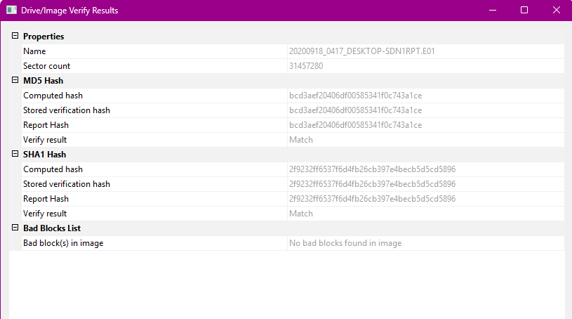
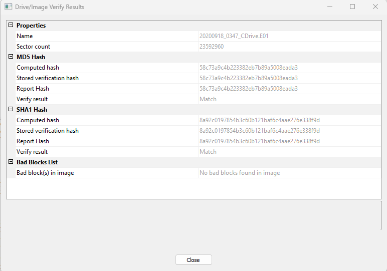

# Case Notes: Szechuan Sauce

## 1. Scenario
**Given (from the lab's case overview):** The FBI contacted the owner of a company after finding his recently developed Szechuan sauce recipe on the dark web. As the incident responder, I was called in to investigate. The lab notes that some files may be corrupted, so if one tool fails another should be tried.

**Evidence provided:** Disk images and memory captures from two systems (a desktop, DESKTOP-SDN1RPT, and a server named citadel-dc01 that appears to be a domain controller), plus a network capture (case001.pcap) and two autoruns CSV exports.

**Objective (my own framing):** Determine how the recipe could have been stolen: how an attacker got in, when, what they accessed, and how data left the network. Document the findings and recommend remediation.

## 2. Evidence received
- Source: CyberDefenders, Szechuan Sauce lab (public training case)
- Downloaded and extracted: 2026-10-12 17:22 BST
- Location: E:\31-SzechuanSauce\temp_extract_dir\c15-SzechuanSauce
- SHA-256 hashes of all files recorded on receipt: see hashes-case01.txt
- Evidence files are treated as read-only; all analysis is on copies or via read-only tools.

## 3. Image verification log
Tool: FTK Imager 8.3.0.27, Verify Drive/Image.

| Image | MD5 (computed = stored) | SHA1 (computed = stored) | Bad blocks | Result |
|---|---|---|---|---|
| 20200918_0417_DESKTOP-SDN1RPT.E01 | bcd3aef20406df00585341f0c743a1ce | 2f9232ff6537f6d4fb26cb397e4becb5d5cd5896 | None | Match |
| 20200918_0347_CDrive.E01 | 58c73a9c4b223382eb7b89a5008eada3 | 8a92c0197854b3c60b121baf6c4aae276e338f9d | None | Match |

## 4. Observations
- Both images: computed hashes match the stored hashes recorded at acquisition (MD5 and SHA1).
- No bad blocks reported in either image.
- No integrity problems found, so analysis can proceed.